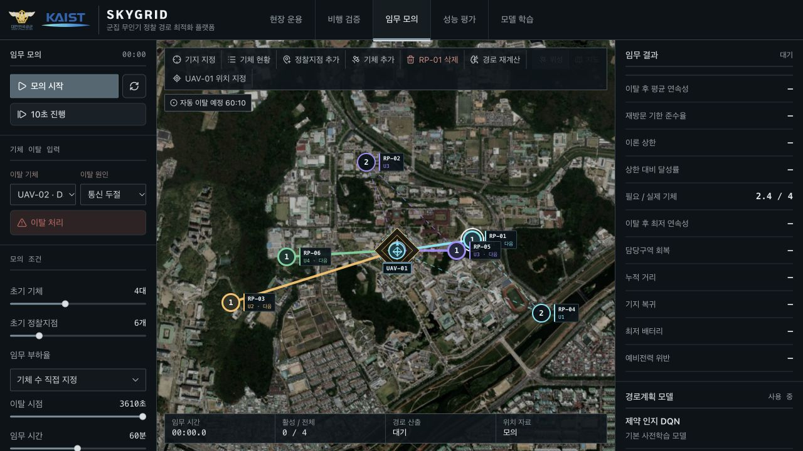
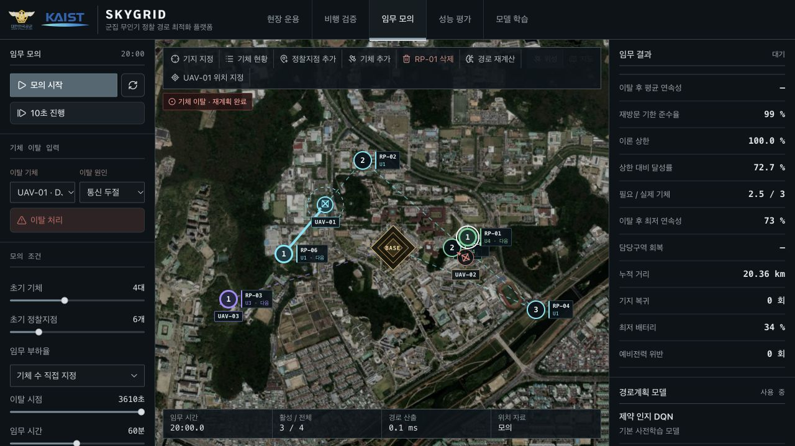
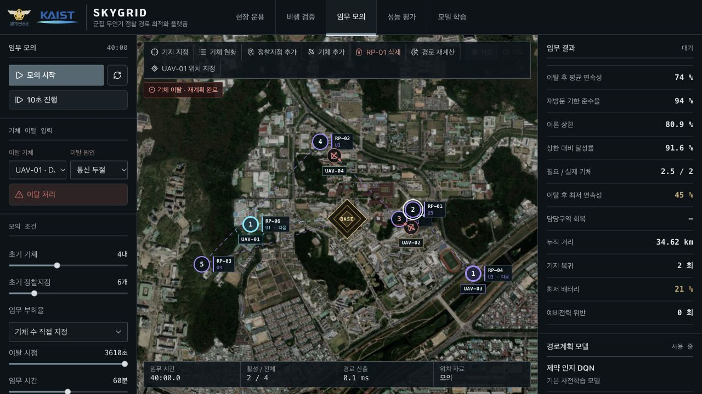
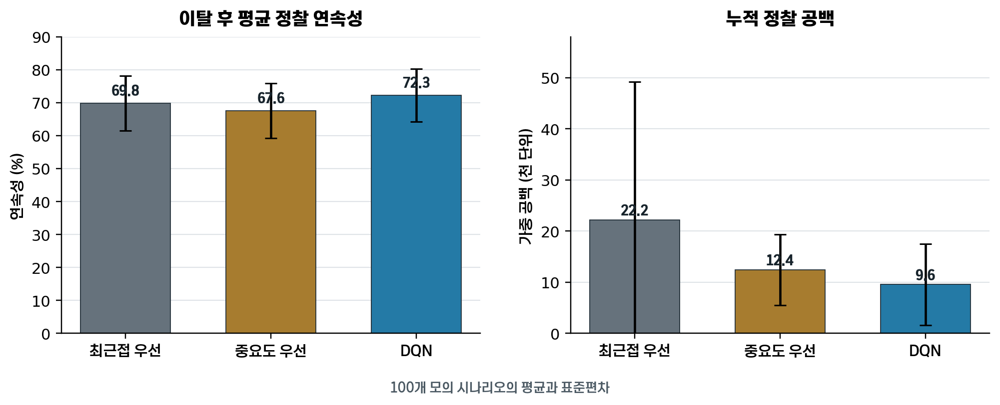

# 정찰 임무 연속성 확보를 위한 강화학습 기반 군집 무인기 운용 경로 최적화

## Reinforcement Learning-Based Route Optimization of Multiple UAVs for Reconnaissance Mission Continuity

정승호¹ · 김선우²  
¹KAIST 항공우주공학과 2학년  
²KAIST 새내기과정학부 1학년

> 작성 메모: `000`은 실험 후 실제 값으로 교체하고, 코드 블록은 한글 수식 편집기에 입력함. 그림·표 삽입 지시와 이 메모는 제출 전 삭제함.

## - 요 약 문 -

소형 무인기는 전술 정찰에 널리 사용되고 있으나, 소수의 기체로 여러 지점을 반복 감시할 때 한 대가 이탈하면 정찰 공백이 빠르게 커질 수 있다. 본 연구에서는 기체의 위치, 배터리와 비행성능, 정찰지점의 중요도와 재방문 기준시간을 고려하여 남은 기체의 경로를 다시 계산하는 웹 기반 임무지원체계 SKYGRID를 개발하였다. 경로 결정에는 심층 Q 신경망(Deep Q-Network, DQN)을 사용하였으며, 최근접 우선 및 중요도 우선 방식과의 모의실험과 DJI Mavic Pro·DJI Avata 2 실비행으로 성능을 확인하였다. 100개 모의 시나리오에서 DQN의 평균 정찰 연속성은 최근접 우선보다 2.50%p, 중요도 우선보다 4.72%p 높았으며, 누적 정찰 공백은 각각 57.0%, 23.1% 감소하였다. 실비행에서는 기체 이탈 입력 후 평균 `000 s` 안에 새로운 경로를 제시하였다. 이 결과는 SKYGRID가 소수의 상용 무인기를 운용하는 부대에서 기체 이탈 후 정찰 공백을 줄이는 데 활용될 수 있음을 보여준다.

**Key Words:** 소형 무인기(Small Unmanned Aerial Vehicle), 지속 정찰(Persistent Surveillance), 심층 Q 신경망(Deep Q-Network), 임무 재할당(Task Reallocation), 경로 계획(Route Planning)

---

# 1. 서 론

우크라이나 전쟁에서는 DJI Mavic 계열과 저비용 FPV 무인기가 전술 정찰과 포병 관측에 널리 사용되고 있다[1,2]. 미 육군도 소대급 실시간 정찰을 위한 Short Range Reconnaissance 무인기를 운용하고 있으며[3], 우크라이나군에는 정찰·FPV 무인기 소대가 편성되었다[4]. 소형 쿼드콥터의 비행시간은 약 20~40분이므로 지속 정찰에는 여러 기체와 배터리의 교대 운용이 필요하다[2].

4대의 편대에서 1대가 피격, 통신 두절, 배터리 이상 또는 고장으로 이탈하면 가용 기체가 25% 감소하고 담당 지점에는 즉시 정찰 공백이 생긴다. 최근접 기체만 투입하면 기존 담당 지점의 방문이 늦어질 수 있고, 중요도만 따르면 이동거리와 배터리 소모가 커진다. 남은 기체의 위치·배터리·비행성능과 지점별 중요도·방문 시급성을 함께 반영한 경로 재계산이 필요한 이유이다.

본 연구에서는 2~5대의 상용 소형 무인기를 대상으로 웹 기반 임무지원체계 SKYGRID를 개발하였다. SKYGRID는 임무 모의, 기체 이탈 후 경로 재계산, 현장 기록 저장과 비행기록 분석을 하나의 체계에서 수행한다. DQN 경로를 최근접 우선 및 중요도 우선 방식과 비교하고, DJI Mavic Pro와 DJI Avata 2의 실비행으로 운용 가능성을 확인하였다.

---

# 2. SKYGRID 시스템

## 2.1 시스템 개요

SKYGRID는 위성지도에서 기지·기체·정찰지점을 배치하고 기체별 담당 지점과 방문순서를 계산하는 웹 기반 임무지원체계이다. 입력값은 기체의 위치·배터리·비행성능과 지점의 중요도·정찰시간·재방문 기준시간이다. 기체가 이탈하면 이동 중인 기체의 현재 목표를 유지하면서 이후 경로와 미배정 지점을 다시 계산한다.

시스템은 임무 모의, 성능 비교, 현장 운용, 현장 기록 재생, 비행기록 분석과 DQN 학습으로 구성하였다. 모든 기능은 동일한 임무 자료구조를 사용하므로 모의조건을 현장 운용에 적용하고, 저장한 기록으로 경로 변화를 재생할 수 있다. 그림 1은 사용자 입력부터 경로 계산과 기록 분석까지의 자료 흐름을 나타낸다.

[그림 1 삽입: 사용자 입력–공통 임무상태–DQN/비교 알고리즘–지도 경로–기록 및 검증으로 이어지는 SKYGRID 구조도]

**그림 1. SKYGRID 시스템 구성 및 데이터 흐름**

## 2.2 임무 모의

임무 모의에서는 기체 종류, 임무시간과 이탈시각을 설정한다. 시뮬레이터는 10초 간격으로 위치, 정찰, 배터리 소모, 기지 복귀와 재출동을 계산하며, 이탈 발생 시 잔여 기체의 경로를 갱신한다. 지도에는 현재 목표와 방문순서를 표시하고, 종료 후 정찰 연속성, 누적 정찰 공백, 공백 회복시간, 비행거리와 배터리 예비량 위반을 산출한다.

성능 비교는 최근접 우선, 중요도 우선과 DQN을 같은 초기조건에서 실행한다. 최근접 우선은 이동거리가 가장 짧은 조합을, 중요도 우선은 중요도와 방문 지연이 큰 지점을 먼저 선택한다. 배터리 모델, 정찰시간과 복귀 절차는 세 방식에 동일하게 적용하였다.

## 2.3 현장 운용

현장 운용에서는 실제 이륙지점과 정찰지점을 지정하고 기체의 위치·배터리를 입력한다. 조종자는 지도에 표시된 방문순서에 따라 DJI Mavic Pro와 DJI Avata 2를 수동으로 비행하였다. 정찰 완료를 입력하면 마지막 방문시각과 다음 경로가 갱신되며, 기체 이상을 입력하면 잔여 기체에 미완료 지점이 재배정된다. 위치·배터리·정찰 완료는 운용자가 입력하였고, 비행안전 판단과 기체 조종은 각 조종자가 담당하였다. 그림 2에 현장 운용 화면을 나타내었다.

[그림 2 삽입: 현장 운용 화면. 기지, 두 기체, 정찰지점 번호, 기체별 다음 경로 및 이탈 보고 기능이 보이도록 캡처]

**그림 2. SKYGRID 현장 운용 화면 구성**

## 2.4 기록 저장 및 비행기록 분석

현장 기록은 초기조건, 기체별 경로, 정찰 완료, 위치·배터리 수정, 기체 이탈과 재계산 결과를 `skygrid.field-record.v1` 형식의 JSON 파일로 저장한다. 저장 파일을 불러오면 임무 중 경로 변화를 시간순으로 재생할 수 있다.

실제 비행궤적은 DJI GO 4와 DJI Fly의 기록을 CSV로 변환하여 사용하였다. Android 기기의 기록 경로는 각각 `DJI/dji.go.v4/FlightRecord`와 `Android/data/dji.go.v5/file/FlightRecord`이다[8]. 복수 기체의 자료를 비행 경과시간으로 동기화한 뒤 비행거리, 속도, 고도, 배터리 소모, 지점 도달률과 계획경로 오차를 계산하였다.

---

# 3. 정찰 임무와 문제 정의

## 3.1 정찰 방식

본 연구는 하나의 기지에서 2~5대의 소형 회전익 무인기로 여러 지점을 반복 정찰하는 상황을 다룬다. 기체는 담당 지점에서 정해진 시간 동안 정찰한 뒤 다음 지점으로 이동하며, 복귀 배터리에 도달하면 기지에서 배터리를 교체하고 재출동한다. 각 지점에는 중요도, 정찰시간과 재방문 기준시간을 부여하였다. 재방문 기준시간은 이전 정찰 종료 후 다음 정찰까지 허용되는 최대 간격이다. SKYGRID는 정찰이 끝날 때마다 다음 담당 기체와 방문순서를 계산한다. 그림 3에 운용개념을 나타내었다.

[그림 3 삽입: 기지에서 출발한 4대의 무인기가 6개 정찰지점을 분담하여 반복 방문하는 임무 개념도]

**그림 3. 소규모 군집 무인기의 반복 정찰 운용 개념**

## 3.2 기체 이탈과 경로 재계산

피격, 충돌, 통신 두절, 배터리 이상 또는 고장으로 기체가 이탈하면 담당 지점에 정찰 공백이 발생한다. SKYGRID는 이탈 기체를 계산에서 제외하고 미완료 지점을 잔여 기체에 재배정한다. 이동 중인 기체의 현재 목표는 유지하고 이후 방문순서만 갱신하여 이미 진행 중인 비행을 방해하지 않도록 하였다. 계산에는 기체의 위치·배터리·기존 임무와 지점의 중요도·마지막 방문시각을 사용한다. 그림 4에 이탈 전후의 경로 변화를 나타내었다.

[그림 4 삽입: 기체 1대 이탈 전·후의 경로 변화. 이탈 기체의 지점이 잔여 기체에 재배정되는 과정을 색상으로 표시]

**그림 4. 기체 이탈 전·후의 정찰지점 재할당**

## 3.3 정찰 공백의 정량화

현재시각 `t`, 지점 `j`의 마지막 방문시각 `l_j`, 재방문 기준시간 `T_j`를 이용하여 정규화 공백함수 `g_j(t)`를 식 (1)과 같이 정의하였다.

```text
g_j(t)=max(0,{t-l_j-T_j} over {T_j})
```

**식 (1). 정찰지점별 정규화 공백 함수**

마지막 방문 후 경과시간이 `T_j` 이내이면 `g_j(t)=0`이며, 기준시간을 초과한 비율만큼 증가한다. 기준시간이 120초인 지점을 180초 만에 방문하면 `g_j(t)=0.5`이다. 지점 중요도 `w_j`, 지점 수 `N`, 임무시간 `T_{mission}`을 반영한 누적 정찰 공백 `J_{gap}`은 식 (2)와 같다.

```text
J_{gap}=int _0 ^{T_{mission}} {sum _{j=1} ^N {w_j g_j(t)}}dt
```

**식 (2). 중요도를 반영한 누적 정찰 공백**

`J_{gap}`은 중요지점이 기준시간을 오래 초과할수록 증가하며, 프로그램에서는 10초 간격의 합으로 적분을 근사하였다. 경로 종합 평가값 `J`에는 총 비행거리 `D_{total}`과 배터리 예비량 위반 벌점 `P_{battery}`를 함께 반영하였다.

```text
min J=J_{gap}+lambda_d D_{total}+lambda_b P_{battery}
```

**식 (3). 군집 무인기 경로 종합 평가함수**

`lambda_d`와 `lambda_b`는 거리와 배터리 벌점의 반영계수이다. 경로 후보는 정상 기체가 정찰 후 기지까지 복귀할 수 있고, 이동 중인 기체의 현재 목적지를 유지하는 경우로 한정하였다.

## 3.4 성능평가 지표

성능은 동일한 초기조건과 이탈 사건에서 DQN, 최근접 우선 및 중요도 우선을 비교하였다. 시각 `t`에서 재방문 기준시간을 지킨 지점의 중요도 비율을 정찰 연속성 `C(t)`로 정의하였다.

```text
C(t)=100 times {{sum _{j=1} ^N {w_j I(t-l_j LEQ T_j)}} over {sum _{j=1} ^N {w_j}}}
```

**식 (4). 중요도 가중 정찰 연속성**

`I(·)`는 괄호 안의 조건이 참이면 1, 거짓이면 0이다. 전체 중요도 합이 10이고 기준시간을 지킨 지점의 중요도 합이 8이면 `C(t)`는 80%이다. 기체 이탈부터 임무 종료까지의 평균을 이탈 후 평균 정찰 연속성으로 사용하였다. 누적 정찰 공백은 지연의 크기와 지속시간을, 공백 회복시간은 이탈 지점의 정찰이 재개되기까지 걸린 시간을 나타낸다. 전체 지표는 표 1과 같다.

**표 1. 경로 결정 방식의 성능평가 지표**

| 평가 지표 | 의미 | 우수 기준 |
|---|---|---|
| 이탈 후 평균 정찰 연속성 | 이탈 뒤 재방문 기준시간을 지킨 중요지점의 비율 | 높을수록 우수 |
| 누적 정찰 공백 | 중요도와 지연시간을 반영한 임무 전체의 공백 | 낮을수록 우수 |
| 공백 회복시간 | 이탈 기체의 담당 지점을 잔여 기체가 다시 정찰하기까지의 시간 | 짧을수록 우수 |
| 총 비행거리 | 모든 기체의 이동거리 합 | 같은 연속성에서 짧을수록 우수 |
| 배터리 예비량 위반 | 안전 복귀 예비량 기준을 위반한 횟수 | 0회가 우수 |

# 4. DQN 기반 경로계획

## 4.1 DQN의 역할

DQN은 현재 상태에서 행동별 장기 보상을 추정하는 강화학습 방법이다[5,12]. SKYGRID에서는 기체 `i`를 지점 `j`에 배정하는 결정을 하나의 행동으로 두고, 정상 기체가 현재 목표를 수행한 뒤 해당 지점을 정찰하고 기지까지 복귀할 수 있는 후보만 평가하였다. 후보별 Q값에 따라 담당 기체와 방문순서를 정하고, 경로 보정 단계를 거쳐 지도에 표시하였다.

## 4.2 입력값과 신경망 구조

기체와 지점 수가 달라도 같은 신경망을 사용하도록 각 배정 후보를 20개의 특성 `phi(s_t,i,j)`로 표현하였다. 기체 4대와 지점 6개이면 최대 24개 후보를 같은 신경망으로 평가한다. 입력값은 표 2와 같이 구성하였다.

**표 2. DQN의 배정 후보별 입력값**

| 범주 | 입력 특성 |
|---|---|
| 거리·시간 | 목표거리, 이동·정찰·배정시간 비율, 목표–기지 거리 |
| 지점 상태 | 중요도, 재방문 시급성, 기준시간 초과, 주변 지점 수, 시간 여유 |
| 기체 상태 | 배터리, 예상 소모비, 복귀 예비량, 거리상 유리한 정도 |
| 편대 상태 | 임무 가능 기체 수, 평균 배터리, 남은 지점 수, 상대 배정량 |
| 경로 상태 | 현재 배정시간과 상수항 |

거리·시간은 이동비용, 지점 상태는 정찰 시급성, 기체·편대 상태는 임무수행 능력과 배정량을 나타낸다. 각 값은 학습 전에 정규화하였다. 신경망은 입력 20개, 은닉노드 64개의 단일 은닉층과 출력 1개로 구성하였으며, 은닉층과 Q값은 식 (5), 식 (6)으로 계산하였다.

```text
z=ReLU(W_1 phi+b_1)
```

**식 (5). DQN 은닉층 출력**

```text
Q(s_t,a_t;theta)=W_2 z+b_2
```

**식 (6). 배정 후보의 Q값**

`theta={W_1,b_1,W_2,b_2}`는 학습 매개변수이다. Q값이 가장 큰 후보를 선택한 뒤 갱신된 상태에서 다음 후보를 평가하는 과정을 반복하여 기체별 방문순서를 구성하였다.

## 4.3 보상함수

보상함수는 한 번의 배정이 이후의 정찰 공백에 미치는 영향을 반영하였다. 배정 전 예상 공백 `J_{gap}^{base}`와 배정 후 예상 공백 `J_{gap}^{a_t}`의 차이를 비교시간 `L`과 대기지점 중요도 합 `W`로 나누어 식 (7)의 정규화 공백 감소량을 계산하였다.

```text
Delta bar J_{gap}={{J_{gap}^{base}-J_{gap}^{a_t}} over {WL}}
```

**식 (7). 배정 후보에 따른 정규화 정찰 공백 감소량**

편대 전체의 지연과 임무 후 복귀 여유를 더하여 후보 보상을 식 (8)과 같이 정하였다.

```text
r_t^{cand}=20 Delta bar J_{gap}-4 bar d_{fleet}-2 max(0,0.1-m_{reserve})
```

**식 (8). 배정 후보의 보상**

`bar d_{fleet}`는 새 배정으로 늘어난 편대 경로의 정규화 지연량이며, `m_{reserve}`는 정찰 후 기지 도착 시 예상 배터리 비율이다. 안전 예비량은 10%로 설정하였다. 한 구간의 누적 공백을 구간시간과 전체 중요도 합으로 나눈 `dot G`는 식 (9)의 모의비행 보상에 사용하였다.

```text
r_t^{sim}=1-4 dot G
```

**식 (9). 모의비행 구간의 보상**

최종 보상은 후보 배정의 예상효과와 모의비행에서 발생한 공백을 식 (10)과 같이 결합하였다.

```text
r_t=0.75 r_t^{cand}+0.25 r_t^{sim}
```

**식 (10). DQN 학습의 최종 보상**

예상 보상과 모의비행 보상의 가중치는 각각 0.75와 0.25로 설정하였다.

## 4.4 학습 방법

배정마다 이동·정찰시간이 다른 점을 반영하여 예상 소요시간 `Delta t`에 따른 시간 할인율을 식 (11)과 같이 적용하였다.

```text
gamma(Delta t)=0.97^{{Delta t} over {60}}
```

**식 (11). 배정 소요시간에 따른 할인율**

기준 할인율 0.97은 1분 뒤의 보상을 현재 가치의 97%로 반영한다. 목표 신경망의 학습 목표는 식 (12)와 같다.

```text
y_t=r_t+gamma(Delta t) max _{a'} Q_{target}(s_{t+1},a')
```

**식 (12). DQN 학습 목표값**

예측오차 `e_t=Q(s_t,a_t;theta)-y_t`에는 Huber 손실을 적용하였다[14].

```text
L(e_t)=cases{{1 over 2}e_t^2&if~~~|e_t| LEQ 1#|e_t|-{1 over 2}&if~~~|e_t|>1}
```

**식 (13). DQN 학습에 사용한 Huber 손실함수**

오차는 -8~8, 기울기는 -1~1로 제한하였다. 재현메모리는 30,000개, 배치크기는 32, 학습률은 0.0002로 설정하였다. 탐색률은 0.85에서 에피소드마다 0.996배씩 줄여 0.03까지 낮추었으며, 목표 신경망은 30에피소드마다 갱신하였다.

학습과 평가는 같은 임무 생성기와 시뮬레이터를 사용하였다. 정찰지점 10~26개, 임무시간 480~720초, 재방문 기준시간 120~300초, 기체 충족률 50·80·100·120%를 조합하였다. 원형·군집형·혼합형 지점 배치와 속도·체공시간이 다른 기체를 사용하고 임무의 35~65% 시점에 기체를 이탈시켰다. 최종 모델은 난수 시드 20261125에서 생성한 1,000개 시나리오로 학습하고, 별도 시드의 20개 시나리오로 검증하였다.

## 4.5 경로 보정

DQN의 초기 배정은 미배정 정상 기체에 수행 가능한 지점을 우선 부여한다. 이동 중인 기체의 첫 목적지를 고정한 뒤 이후 방문순서를 2-opt로 최대 8회 보정하였다[9]. DQN은 담당 지점을 선택하고 2-opt는 방문순서와 경로길이를 조정한다.

---

# 5. 모의실험

## 5.1 실험 목적

모의실험에서는 동일한 기지, 정찰지점, 기체 성능, 배터리와 이탈시각을 적용하여 DQN, 최근접 우선 및 중요도 우선의 경로를 비교하였다. 정상 운용부터 두 차례의 기체 이탈까지 연속해서 모의하고, 지점 배치와 기체 수를 바꾼 추가 시나리오로 결과의 반복성을 확인하였다.

## 5.2 실험 조건

기준 시나리오는 KAIST 캠퍼스에 기지 1개, 정찰지점 6개와 가상기체 4대를 배치하여 구성하였다. 임무시간은 60분이며 지점마다 중요도, 정찰시간과 재방문 기준시간을 다르게 설정하였다. 주요 조건은 표 3과 같다.

**표 3. 기준 모의실험 조건**

| 항목 | 설정값 |
|---|---|
| 운용 구성 | 기지 1개·정찰지점 6개·기체 4대 |
| 임무 설정 | 임무시간 60 min·계산 간격 10 s |
| 정찰 조건 | 중요도 1~5·재방문 120~300 s·정찰 20~80 s |
| 배터리 조건 | 초기 100%·복귀 예비량 20%·교체 40~50 s |
| 기체 이탈 | 20 min에 1대, 40 min에 1대 추가 |
| 비교 방법 | 최근접·중요도·DQN, 각 100회 |

시뮬레이터는 10초마다 위치와 배터리를 갱신하고 정찰, 복귀, 배터리 교체와 재출동을 처리하였다. 20분과 40분에 기체를 한 대씩 이탈시켜 가용 기체를 4대에서 3대, 다시 2대로 줄였다. 난수 시드 20261125부터 시드 값을 17씩 증가시켜 100개의 지점 배치와 정찰조건을 생성하였으며, 각 시나리오에서 세 방식을 같은 조건으로 비교하였다.

## 5.3 모의비행 절차

네 기체는 기지에서 출발하여 배정된 지점을 반복 정찰하였다. 이탈시각에는 해당 기체의 이동을 중지하고 남은 경로를 삭제한 뒤, 미완료 지점을 잔여 기체에 재배정하였다. 이동 중인 기체는 현재 목적지를 마친 후 갱신된 경로를 따랐다. 임무 종료 후 이탈 후 평균 정찰 연속성, 누적 정찰 공백, 공백 회복시간, 총 비행거리와 배터리 예비량 위반을 계산하였다. 실험 과정은 그림 5와 같다.









**그림 5. 기체 이탈에 따른 모의비행 경로와 정찰 연속성의 변화**

결과는 평균과 표준편차로 정리하고, 자료의 분포에 따라 반복측정 분산분석 또는 Friedman 검정을 적용하였다. 유의수준은 0.05로 설정하였다.

## 5.4 실험 결과

기준 시나리오의 결과는 표 4와 같다.

**표 4. 기준 시나리오의 경로 결정 방식별 성능**

| 지표 | 최근접 우선 | 중요도 우선 | DQN |
|---|---:|---:|---:|
| 이탈 후 평균 연속성(%) | 69.78±8.35 | 67.55±8.30 | 72.27±8.01 |
| 누적 정찰 공백 | 22,227±26,962 | 12,431±6,949 | 9,560±7,961 |
| 평균 공백 회복시간(s) | 352±308 | 336±243 | 359±209 |
| 총 비행거리(km) | 18.49±6.20 | 26.56±6.14 | 29.63±6.64 |
| 예비량 위반(회) | 0 | 0 | 0 |

주: 표의 값은 100개 시나리오에서 얻은 평균±표준편차임.

DQN의 이탈 후 평균 정찰 연속성은 72.27%로 최근접 우선보다 2.50%p, 중요도 우선보다 4.72%p 높았다. 세 방식의 차이는 통계적으로 유의하였다(`p<0.001`). 누적 정찰 공백은 DQN이 최근접 우선보다 57.0%, 중요도 우선보다 23.1% 낮았으며(`p<0.001`), 100개 시나리오 중 64개에서 가장 낮은 값을 기록하였다. 평균 공백 회복시간은 세 방식 사이에 유의한 차이가 없었다(`p=0.151`). DQN의 총 비행거리는 최근접 우선보다 60.2%, 중요도 우선보다 11.6% 길었다.

---

# 6. 실비행

## 6.1 실험 목적 및 장비

실비행은 SKYGRID가 제시한 경로의 현장 운용과 기록 분석 기능을 확인하기 위해 수행하였다. DJI Mavic Pro와 DJI Avata 2를 각 1대 사용하고, 두 조종자가 지도에 표시된 담당 지점과 방문순서를 보며 수동으로 비행하였다. Mavic Pro는 DJI GO 4, Avata 2는 DJI Fly를 사용하였으며 SKYGRID는 `000`에서 실행하였다. 주요 제원과 시험조건은 표 5와 같다.

**표 5. 실비행 기체 및 SKYGRID 프로파일**

| 항목 | DJI Mavic Pro | DJI Avata 2 |
|---|---:|---:|
| 최대 비행시간/속도 | 27 min/18.06 m/s | 23 min/27 m/s |
| 이륙중량 | 734 g | 약 377 g |
| 실험 순항속도·고도 | `000 m/s`·`000 m` | `000 m/s`·`000 m` |
| 복귀 예비량 | `000 %` | `000 %` |
| 경로 수행 | SKYGRID 지도를 보며 수동비행 | SKYGRID 지도를 보며 수동비행 |
| 비행기록 | DJI GO 4 | DJI Fly |
| 위치기록 간격 | `000 s` | `000 s` |

## 6.2 실험 조건

실비행은 `000년 000월 000일` 경기도 광명시 `000 구역`에서 총 `000회` 수행하였다. 이륙지점을 기지로 정하고 안전구역 안에 정찰지점 `000개`를 배치하였다. 풍속은 `000 m/s`, 기온은 `000 ℃`였다.

정상 운용에서는 두 기체가 초기 경로를 수행하였다. 이탈 시험에서는 Mavic Pro를 복귀시킨 뒤 SKYGRID에서 이탈 처리하고, Avata 2가 재계산된 경로로 미완료 지점을 정찰하였다. 재투입 시험에서는 Mavic Pro를 다시 임무 가능 상태로 바꾸어 남은 지점을 두 기체에 재배정하였다. 세부 내용은 표 6과 같다.

**표 6. 실비행 시나리오와 확인 항목**

| 구분 | 운용 절차 | 확인 항목 | 반복 |
|---|---|---|---:|
| F1 정상 운용 | 두 기체가 초기 배정경로를 수행 | 지점 도달률, 경로오차, 배터리 소모 | 000회 |
| F2 단일기 이탈 | `000 s`에 Mavic Pro를 이탈 처리하고 기지로 복귀 | 재계산 시간, 공백 회복시간 | 000회 |
| F3 재투입 | 이탈 후 `000 s`에 Mavic Pro를 다시 투입 | 재분배 시간, 연속성 변화 | 000회 |

세 시험에는 같은 기지, 정찰지점과 정찰시간을 적용하고 Mavic Pro의 복귀 시작시각과 이탈 입력시각을 함께 기록하였다.

## 6.3 비행 방법

비행 전 기체상태, 배터리, 프로펠러, 위성수, 홈포인트와 자동 복귀 고도를 확인하였다. 현장 기록을 시작한 뒤 두 기체를 차례로 이륙시키고 지도에 표시된 다음 정찰지점으로 이동하였다. 지점 반경 20 m 안에서 `000 s` 동안 정찰한 뒤 완료를 입력하면 다음 목적지가 표시되었다.

Mavic Pro를 이탈 처리한 시점부터 Avata 2에 새 경로가 표시될 때까지의 시간을 기록하였다. Avata 2가 미완료 지점을 정찰한 뒤 Mavic Pro를 재투입하고, 두 기체에 경로가 다시 분배되는 과정까지 수행하였다. 그림 6은 초기 경로, 이탈·재투입 후 경로와 실제 GPS 궤적을 함께 나타낸다.

[그림 6 삽입: (a) 시험구역의 기지와 정찰지점, (b) 초기 배정경로와 실제 GPS 궤적, (c) Mavic Pro 이탈 후 변경된 경로, (d) Mavic Pro 재투입 후 경로]

**그림 6. 실비행 절차와 SKYGRID 계획경로·GPS 궤적 비교**

## 6.4 비행기록 처리 및 평가

임무 종료 후 SKYGRID 기록은 JSON으로 저장하고 DJI GO 4와 DJI Fly의 비행기록은 CSV로 변환하였다[8]. JSON에서 기체상태, 정찰 완료와 계획경로를, CSV에서 GPS 위치·고도·속도·배터리를 추출하였다. 두 자료는 이륙시각과 이탈 입력시각으로 동기화하였으며 오차는 `000 s` 이내였다.

계획경로와 실제 비행의 일치도는 평균 경로오차 `E_{path}`로 평가하였다. 실제 GPS 표본 수를 `K`, 시각 `k`의 실제 위치를 `x_k`, 계획경로를 이루는 선분의 집합을 `P`라 두고 식 (14)와 같이 계산하였다.

```text
E_{path}={1 over K} sum _{k=1} ^K {min _{p in P} d(x_k,p)}
```

**식 (14). 계획경로와 실제 GPS 궤적의 평균 오차**

`d(x_k,p)`는 실제 위치와 계획경로 선분 사이의 최단 지상거리이다. 지점 중심 20 m 이내에서 정찰시간을 채우면 도달로 판정하였다. 재계산 시간은 이탈 입력부터 새 경로 표시까지, 공백 회복시간은 잔여 기체가 이탈 기체의 미완료 지점을 정찰할 때까지로 측정하였다.

## 6.5 실비행 결과

총 `000회`의 비행 가운데 `000회`를 계획대로 완료하였다. 주요 결과는 표 7과 같다.

**표 7. 실비행 및 현장 경로 재계산 결과**

| 지표 | F1 정상 | F2 이탈 | F3 재투입 |
|---|---:|---:|---:|
| 정찰지점 도달률(%) | 000 | 000 | 000 |
| 평균 경로오차(m) | 000 | 000 | 000 |
| 경로 재계산 시간(s) | - | 000 | 000 |
| 공백 회복시간(s) | - | 000 | 000 |
| 이탈 후 평균 연속성(%) | - | 000 | 000 |
| 최저 배터리(%) | 000 | 000 | 000 |

정상 운용에서 두 기체의 지점 도달률은 각각 `000 %`, `000 %`, 평균 경로오차는 `000 m`, `000 m`였다. Mavic Pro 이탈 입력 후 `000 s` 만에 Avata 2의 새 경로가 표시되었고 `000 s` 뒤 미완료 지점의 정찰이 완료되었다. Mavic Pro 재투입 후에도 경로가 두 기체에 다시 분배되었다.

현장 기록으로 세 방식을 재계산한 결과 평균 정찰 연속성은 DQN `000 %`, 최근접 우선 `000 %`, 중요도 우선 `000 %`였다. DQN의 성능 차이는 `000`이었으며, 경로 제시부터 이탈·재투입, 기록 저장과 재생까지의 현장 운용 절차가 모두 수행되었다.

---

# 7. 결과 분석

## 7.1 경로계획 성능

모의실험에서 DQN은 두 비교 방식보다 높은 정찰 연속성과 낮은 누적 정찰 공백을 보였다. DQN이 중요지점의 지연을 줄이기 위해 더 긴 경로를 선택하면서 총 비행거리는 최근접 우선보다 60.2% 증가하였다. 정찰 공백 감소와 이동거리 사이의 가중치를 조정하면 연속성을 유지하면서 이동부담을 낮출 수 있다.

## 7.2 연구 범위와 후속 과제

실비행은 두 대의 기체와 운용자 입력 방식으로 수행하였다. 후속 시험에서는 4~5대 동시비행과 기체정보 자동연동을 적용하고, 지점 배치·기종·이탈조건을 확대한 자료로 DQN을 재학습할 계획이다.

---

# 8. 결 론

본 연구에서는 소수의 무인기로 반복 정찰임무를 수행할 때 기체 이탈에 대응하는 웹 기반 임무지원체계 SKYGRID를 개발하였다. 기지와 정찰지점 설정, DQN 경로계산, 기체 이탈 후 재배정, 현장 기록 저장과 비행결과 분석을 하나의 플랫폼에 구현하였다.

100개 모의 시나리오에서 DQN의 평균 정찰 연속성은 최근접 우선보다 2.50%p, 중요도 우선보다 4.72%p 높았으며 누적 정찰 공백은 각각 57.0%, 23.1% 감소하였다. 반면 총 비행거리는 증가하여 보상함수의 거리 가중치 조정이 필요한 것으로 나타났다. DJI Mavic Pro와 DJI Avata 2의 실비행에서는 조종자가 SKYGRID 경로를 따라 정찰하고, 기체 이탈과 재투입에 맞춰 갱신된 경로로 임무를 이어갔다. 본 연구의 의의는 소규모 무인기 부대가 현장에서 사용할 수 있는 임무지원 플랫폼을 구현하고 그 운용과정을 실제 비행으로 확인한 데 있다.

---

# -참고 문헌-

[1]UK Ministry of Defence, Defence Drone Strategy: The UK’s Approach to Defence Uncrewed Systems, UK Ministry of Defence, 2024.

[2]NATO Joint Analysis and Lessons Learned Centre, Powering the Front: Tactical Energy Delivery and Management in the Ukraine War, NATO Joint Analysis and Lessons Learned Centre, 2026.

[3]https://www.army.mil/article/276260/the_army_delivers_srr_uas_to_the_first_transformation_in_contact_brigade_combat_team (검색일 : 2026. 10. 13.)

[4]https://www.army.mil/article/284138/tactical_reconnaissance_strike_in_ukraine_a_mandate_for_the_u_s_army (검색일 : 2026. 10. 13.)

[5]V. Mnih, K. Kavukcuoglu, D. Silver et al., Human-level control through deep reinforcement learning, Nature, Nature Publishing Group, 2015.

[6]Y. Chen, Q. Dong, X. Shang, Z. Wu and J. Wang, Multi-UAV Autonomous Path Planning in Reconnaissance Missions Considering Incomplete Information: A Reinforcement Learning Method, Drones, MDPI, 2023.

[7]J. Westheider, J. Rückin and M. Popović, Multi-UAV Adaptive Path Planning Using Deep Reinforcement Learning, arXiv, Cornell University, 2023.

[8]https://repair.dji.com/help/content?customId=en-us03400006894&documentType=artical&lang=en&paperDocType=paper&re=US&spaceId=34 (검색일 : 2026. 10. 08.)

[9]G. A. Croes, A Method for Solving Traveling-Salesman Problems, Operations Research, Operations Research Society of America, 1958.

[10]https://www.dji.com/mavic/info (검색일 : 2026. 10. 08.)

[11]https://www.dji.com/avata-2/specs (검색일 : 2026. 10. 08.)

[12]R. S. Sutton and A. G. Barto, Reinforcement Learning: An Introduction, MIT Press, 2018.

[13]https://github.com/omnibus1016/skygrid, https://omnibus1016.github.io/skygrid/ (검색일 : 2026. 10. 24.)

[14]P. J. Huber, Robust Estimation of a Location Parameter, The Annals of Mathematical Statistics, Institute of Mathematical Statistics, 1964.

---

## 제출 전 `000` 교체 확인표

1. 초록: 모의실험 성능 5개, 실비행 성능 3개
2. 저자 소속의 정확한 영문 표기 및 교신저자 정보
3. 기준 시나리오: 좌표, 정찰시간, 이탈시각, 반복 수, 난수 시드
4. 최종 모델: 학습 에피소드, 학습시간, 검증 시나리오 수, 모델 해시
5. 모의결과 표: 세 방식의 평균·표준편차, 유의확률, 효과크기
6. 실비행: 날짜, 장소, 승인조건, 기상, 장비, 반복 수
7. 실비행 판정기준: 최소 정찰시간, 시간 동기화 오차
8. 실비행 결과: 평균 경로오차, 경로 재계산 시간, 공백 회복시간, 최저 배터리, 현장 기록 재생 비교
9. 그림 1~6: 시스템 화면, 모의비행 절차·경로, 실비행 절차·GPS 궤적과 비행 사진
10. 공개자료: Git 커밋, 앱 버전, 데이터·모델 공개주소
